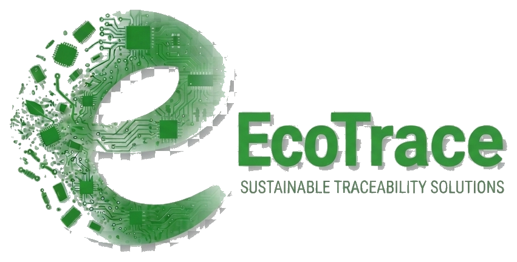

<p align="center">
  
</p>

<h1 align="center">EcoTrace</h1>

<p align="center">
  <strong>An E-Waste Collection, Tracking and Rewards System</strong><br />
  Kansanga · Makindye Division · Kampala · Uganda
</p>

---

EcoTrace is the working system described in the final-year project proposal **“EcoTrace: An E-Waste Collection, Tracking And Rewards System”** (Group F - Kateme Martha, Kyotanabona Barbra, Tusime Daphine; Kampala International University, October 2026; supervisor Dr. Chukwuemeka Odi Agwu). It is a role-based web and mobile platform that connects people who hold e-waste to certified collectors, tracks every item from the owner’s home to the recycling floor through a recorded custody chain, and rewards verified responsible disposal with wallet credits and a numbered disposal certificate.

The official logo is **`bg.png`** (repo root). It is used across the entire system - web app header, footer, sidebar, auth card, landing page, plus the Flutter app welcome, login and home screens. The browser favicon (`web/public/favicon.png`) is the circular "e" mark cropped from the same logo.

## 1. Problem statement

Households and companies in Ugandan towns dispose of e-waste informally: owners find collectors by word of mouth, arrange pickups by phone, and hand items over with no record, while much of the waste is burned, dismantled in backyards or dumped with general refuse. There is **no integrated, traceable and incentive-driven e-waste management system** - certified collectors are hard to find, nothing verifies what happens to an item after it leaves the owner’s hands, recycling centers cannot reliably account for what they receive, and there is no incentive to dispose of e-waste properly, so burning and dumping remain the cheapest option.

The consequences are contamination of air, soil and water by lead, mercury and cadmium; loss of valuable recoverable materials; and an inability for authorities (KCCA, NEMA) to detect illegal dumping or measure environmental impact. Globally only ~22% of the 62 million tonnes of e-waste generated in 2022 was documented as formally collected and recycled (Global E-waste Monitor 2024), and Africa formally recycled less than 1%.

## 2. Objectives

**Main objective:** connect e-waste owners to certified collectors, track e-waste from the point of origin to recycling, and reward responsible disposal.

**Specific objectives** (as per the proposal):

1. Find what e-waste people in Kansanga throw away.
2. Learn how homes, shops and repair stalls keep old phones and computers, who picks them up, and what finally happens to them.
3. Check what people know about e-waste and how they act.
4. Study the laws on e-waste in Uganda and the offices in charge (KCCA, NEMA) and how well the rules are followed.
5. Suggest simple, workable ways of handling e-waste better, beginning in Kansanga.

The system operationalises these objectives by producing the neighbourhood-level, item-level evidence base that the study finds missing, and by giving residents, collectors, recyclers and regulators one shared workflow.

## 3. Research gaps addressed

The proposal identifies three central research gaps; EcoTrace is the chain that closes them:

| Gap (proposal §2.2) | How EcoTrace addresses it |
| --- | --- |
| **2.2.1 No integrated collection-to-tracking workflow** - owners search informally; actors keep separate, unconnected records | One system for collection requests, collector assignment and status updates: `PENDING → ASSIGNED → COLLECTED → IN_TRANSIT → RECEIVED → PROCESSED/REJECTED`, shared by all four roles over a single REST API |
| **2.2.2 Weak item-level traceability** - recording a pickup does not prove an item reached a suitable facility | Every item is a first-class record (type, quantity, condition, photo); every request carries an immutable `RequestEvent` audit trail; a collection is complete only when a recycler enters a processing outcome, which mints a numbered certificate |
| **2.2.3 Rewards not tied to verified recycling** - incentives exist in the literature but are never linked to confirmed recycling | The consumer wallet is credited **only when a recycler marks the request PROCESSED**; rejected or cancelled requests never pay. Payouts are mobile-money redemptions approved by an admin |

## 4. Scope

**Geographic:** the map and drop-off finder are scoped to **Kansanga, Makindye Division, Kampala**; locations outside Kansanga are not shown there. The system is data-driven - new towns, drop-off points, collectors and recycling centres can be added as data, while the map remains intentionally limited to Kansanga for this pilot.

**Content:** a role-based e-waste management system covering the entire lifecycle - user registration and role-based access for households/companies, collectors, recyclers and administrators; logging of item type, quantity, condition and location; pickup requests automatically matched to certified collectors **in the same town**; a strictly tracked workflow; automatic material categorisation as reusable / recyclable / **hazardous** (dangerous components are flagged for specialised handling); a continuous source-to-disposal custody audit trail; recycling-centre intake and processing records; verifiable disposal certificates; environmental metrics (town-level volumes and estimated Carbon Dioxide savings); and a non-negative rewards wallet.

## 5. System overview

### 5.1 Actors and features

| Role | Features |
| --- | --- |
| **Consumer** (households & companies) | Register with phone number; log e-waste items (category, type, quantity, condition, photo); see reward and carbon-offset estimates per item; request a pickup or find the nearest certified drop-off point; track chain-of-custody live; receive a notification on every status change; view wallet and redeem to mobile money; hold numbered disposal certificates (`ECO-…`); map of drop-off points |
| **Collector** | See available pickups **matched to their town**; claim or release jobs; mark items COLLECTED then IN_TRANSIT; digital work history |
| **Recycler** (recycling-centre staff) | Incoming-shipment dashboard; record what arrived (expected vs received counts, hazard flags); process batches (recycling / refurbishment / dismantling / safe disposal); reject mismatched consignments; processing unlocks the consumer’s reward and certificate |
| **Administrator** | Manage users (add, edit, activate/deactivate); manage waste categories, item types (reward + carbon factors + hazard flags) and drop-off points; approve mobile-money redemptions; reports: requests, items, processed counts, **Carbon Dioxide avoided**, reward credits, volumes **by town and period**, users by role, items by category |

### 5.2 Request lifecycle

```
Consumer logs items ──► Creates request (PICKUP or DROPOFF)      [PENDING]
Collector claims (same town)                                     [ASSIGNED]
Collector confirms hand-off                                      [COLLECTED]
Collector en route to facility                                  [IN_TRANSIT]
Recycler records intake (counts verified)                        [RECEIVED]
Recycler processes batch  ──► wallet credit + certificate        [PROCESSED]
         └── or rejects consignment                              [REJECTED]
Consumer may cancel while pending                                [CANCELLED]
```

Every transition writes a `RequestEvent` (status, note, actor, timestamp) and notifies the consumer. Rewards and the carbon snapshot are written exactly once, at `PROCESSED`.

### 5.3 Functional requirements → implementation

| # | Proposal functional requirement | Implementation |
| --- | --- | --- |
| 1 | User registration and login (phone + password) | JWT auth (`/api/auth/register/`, `/api/auth/token/`, `/api/auth/me/`); phone is the username |
| 2 | Role-based access | `CONSUMER`, `COLLECTOR`, `RECYCLER`, `ADMIN`; enforced by DRF permission classes on every endpoint |
| 3 | E-waste logging by category/type/quantity | `Category` → `ItemType` → `Item` (quantity, condition, notes, photo) |
| 4 | **Carbon-offset estimation** | `ItemType.carbon_factor_kg` × quantity gives a live estimate on every item and request; verified disposal snapshots it onto the request and certificate |
| 5 | Collection request, or drop-off advice | `PICKUP` (address + preferred date) or `DROPOFF` (nearest certified point from `DropOffPoint`) |
| 6 | Assignment and scheduling to a same-town collector | `scope=available` matches pending requests to the collector’s town (override with `?town=…` or `town=all`) |
| 7 | Collector task management | Assigned / available / all lists; claim, release, COLLECTED / IN_TRANSIT transitions |
| 8 | Status notifications | `Notification` rows created on every transition, intake, processing, rejection and payout; users can expand details, follow linked requests, delete individual notifications, or clear all |
| 9 | Recycler control dashboard | Incoming list (in-transit/received), receive with expected-vs-received counts, process with method + notes, reject with reason |
| 10 | Account management | Admin CRUD on `/api/users/` incl. activate/deactivate |
| 11 | Reporting | `/api/reports/summary/` - totals, by status, processed, recycled items, **carbon_saved_kg**, reward credits, **by_town volumes**, users by role, categories; filterable by town and date range |

### 5.4 Non-functional requirements → how met

| Requirement (proposal §3.8.2) | How EcoTrace meets it |
| --- | --- |
| Passwords stored hashed | Django password hashing (PBKDF2) |
| Encrypted communication | HTTPS/TLS at deployment (local dev runs on localhost) |
| Access control by role | Permission classes on every view; consumers cannot list users; only collectors claim; only recyclers/admins receive & process |
| ~3 second response | Lightweight DRF endpoints, indexed queries, paginated lists (20/page, max 100) |
| Runs on cheap phones | Small SPA bundle; Flutter app with no heavy dependencies |
| Usability (SUS ≥ ~68) | One-screen flows, status chips, plain-language labels; evaluated with the System Usability Scale in the appendix |
| Reliability & daily backups | SQLite for the local pilot / PostgreSQL in deployment; standard DB backup rotation |
| Data integrity | Requests, items and processing records are transactional (`transaction.atomic`); a collection completes only with a disposal outcome |
| Maintainability | Split into three Django apps (`core`, `waste`, `rewards`) and modular React/Flutter clients |
| Legal compliance | Data collected is limited to what the service needs (phone, name, town, address, coordinates); follows Uganda’s Data Protection and Privacy Act, 2019 |

## 6. Architecture & technology

Three-layer architecture (proposal Figure 3.8): a **presentation layer** (browser SPA + Flutter mobile), an **application layer** (Django REST API holding auth, logging, carbon estimation, scheduling, notifications and reporting), and a **data layer** (relational database + logs).

| Layer | Stack |
| --- | --- |
| Web UI | React 19, Vite, React Router (`web/`) |
| Mobile UI | Flutter - Android, iOS, web (`mobile/`) |
| API | Python, Django ≥ 6.1, Django REST Framework, SimpleJWT, django-cors-headers (`backend/`) |
| Database | PostgreSQL in deployment; SQLite fallback for local development |
| Version control | Git; automated tests in Python (Django TestCase) and linting/analyses for JS/Dart |

## 7. Data model (backend apps)

- **`apps.core`** - `User` (phone, role, town, address, coordinates), `Notification`
- **`apps.waste`** - `Category`, `ItemType` (reward UGX, carbon factor, hazard flag), `DropOffPoint`, `Item`, `CollectionRequest` (+ `carbon_kg` snapshot), `RequestEvent` (audit trail), `ProcessingRecord` (intake + method), `Certificate` (`ECO-…` code, carbon snapshot)
- **`apps.rewards`** - `Wallet` (non-negative balance, atomic credit/debit), `WalletTransaction`, `Redemption` (mobile money, admin-approved)

## 8. Running the system locally

### 8.1 Backend (Django REST API)

```bash
cd backend
python -m venv ../.venv && source ../.venv/bin/activate
pip install -r requirements.txt
python manage.py migrate
python manage.py seed_ecotrace     # categories, item types, drop-off points, demo users
python manage.py runserver         # http://localhost:8000
```

Configuration is read from `backend/.env`. With no Postgres variables set, SQLite (`backend/db.sqlite3`) is used automatically.

**Seed demo accounts** (phone · password · role):

| Phone | Password | Role |
| --- | --- | --- |
| `+256761095861` | Set privately in `backend/.env` | Administrator |
| `+256700000011` | `collect12345` | Collector |
| `+256700000012` | `recycle12345` | Recycler |
| `+256700000013` | `consumer12345` | Consumer |

Use the web administrator sign-in at `http://localhost:5173/admin/login`. After authorization, administrators land on the role-specific home page at `/`; the detailed Reports feature is at `/admin`. Reports and Audit Trail have branded print layouts; choose **Save as PDF** in the browser's print dialog to export them. The Categories page supports creating categories and item types, and searchable lists are available for requests, items, users, categories, payouts, notifications, shipments, drop-off points, and audit entries. The dedicated API login is `POST /api/auth/admin/token/`; the backend checks the account's stored role and issues no token to non-admin users. Admin API routes also enforce server-side permissions, so changing a URL or browser-stored role does not grant access. Django's built-in administration site is a separate endpoint at `http://localhost:8000/admin/`.

Set `ECOTRACE_ADMIN_PHONE` and `ECOTRACE_ADMIN_PASSWORD` in `backend/.env` before seeding; do not put administrator passwords in source control or documentation. The seed command resets the configured administrator's password and repairs its role, active status, and staff access; it also disables the legacy demo administrator. When `DJANGO_DEBUG=0`, configure a unique `DJANGO_SECRET_KEY` of at least 32 characters; the app refuses to start in production mode with the development signing key.

### 8.2 Web app (React + Vite)

```bash
cd web
npm install
npm run dev          # http://localhost:5173
```

Points at the API via `VITE_API_URL` (default `http://localhost:8000/api`). `npm run build` produces `dist/`; `npm run lint` runs Oxlint.

### 8.3 Mobile app (Flutter)

```bash
cd mobile
flutter pub get
flutter run          # Android emulator defaults to http://10.0.2.2:8000/api
```

Override the API base URL with `--dart-define=API_URL=...`.

### 8.4 Verifying a full cycle locally

1. Sign in as the **consumer**, log items (watch reward + Carbon Dioxide estimates), request a pickup.
2. Sign in as the **collector** - the pickup appears under Available (same town); claim → COLLECTED → IN_TRANSIT.
3. Sign in as the **recycler** - receive the consignment, then process it: the consumer’s wallet is credited and a certificate is issued.
4. Sign in as the **admin** - reports show the processed request, Carbon Dioxide avoided, rewards paid and town volumes; approve any pending redemption.

## 9. API reference (summary)

| Method & path | Purpose |
| --- | --- |
| `POST /api/auth/admin/token/` | Rate-limited administrator-only JWT login |
| `POST /api/auth/register/` · `POST /api/auth/token/` · `GET /api/auth/me/` | Registration, JWT login, profile |
| `GET /api/audit-logs/` | Admin-only, searchable audit of API activity and sign-in attempts |
| `GET /api/auth/notifications/` · `POST …/{id}/read/` · `POST …/read-all/` | List notifications, mark one or all as read |
| `DELETE /api/auth/notifications/{id}/` · `DELETE …/clear/` | Delete one notification or clear all |
| `GET/POST/PATCH/DELETE /api/users/` | Admin account management (+ `toggle-active`) |
| `GET/POST/PATCH/DELETE /api/categories/` · `/api/item-types/` | Catalogue (write = admin) |
| `GET/POST/PATCH/DELETE /api/dropoff-points/` | Certified drop-off points (list is public) |
| `GET/POST/PATCH/DELETE /api/items/` | E-waste logging |
| `POST /api/requests/` | Create collection request |
| `GET /api/requests/list/` | Role-scoped lists (`scope=available&town=…`, `status`, `from`, `to`, `q`, paging) |
| `GET /api/requests/{id}/` | Full detail: items, events, certificate, processing |
| `POST /api/requests/{id}/claim/` · `release/` · `transition/` · `cancel/` | Collector & consumer workflow |
| `POST /api/requests/{id}/receive/` · `process/` · `reject/` | Recycler intake & disposal |
| `GET /api/wallet/` · `POST /api/wallet/redeem/` · `GET /api/wallet/stats/` | Wallet & redemptions |
| `GET /api/redemptions/` + approve/reject actions | Admin payout control |
| `GET /api/reports/summary/` | Impact reports (town & date filters) |

## 10. Testing

```bash
cd backend
python manage.py test apps
```

The suite covers: registration & login; the **full disposal flow** (request → claim → collect → transit → receive → process → wallet credit + certificate + carbon snapshot); role-scoped request lists; **town-based collector matching**; **hazardous-item flagging**; wallet redemption & admin approval; admin reports incl. carbon; access control (consumers cannot list users or process).

## 11. Branding

`bg.png` is the single logo asset for the whole system:

- **Web** - `web/public/bg.png`: site header, footer, sidebar brand, auth card, impact card, certificate seal; `web/public/favicon.png`: circular "e" mark used as the browser favicon (`web/index.html`).
- **Mobile** - `mobile/assets/images/bg.png`: welcome, login and home app-bar (`pubspec.yaml` asset).
- **Docs** - this README.

To rebrand, replace `bg.png` at the repo root and re-copy it to `web/public/` and `mobile/assets/images/` - no code changes needed.

## 12. Project structure

```
E-WASTE/
├── bg.png                 # Official logo - used by web + mobile + docs
├── EcoTrace.docx           # Project proposal (source of the requirements in this README)
├── backend/                # Django REST API
│   ├── apps/
│   │   ├── core/           # User (phone + role), auth, notifications
│   │   ├── waste/          # Catalogue, items, requests, audit trail, processing, certificates
│   │   └── rewards/        # Wallet, transactions, redemptions
│   ├── config/             # settings, urls
│   └── manage.py
├── web/                    # React + Vite SPA
│   ├── public/bg.png
│   └── src/
└── mobile/                 # Flutter app
    └── assets/images/bg.png
```

## 13. Ethical considerations

The study follows the proposal’s ethics protocol: institutional approval, permission from local leaders and Makindye Division offices, registration with UNCST where required, informed consent, and compliance with Uganda’s Data Protection and Privacy Act, 2019 - only data the service needs is collected, and participants may withdraw.
# EcoTrace
